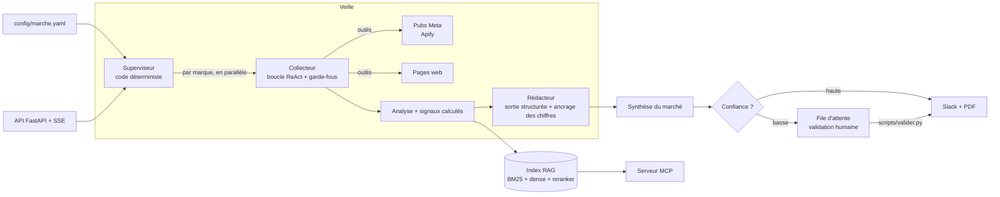

# veille-agents

Veille publicitaire automatique pour un marché de marques de cosmétiques en France : des agents collectent les publicités et les pages des marques, un rédacteur en tire des constats chiffrés, un RAG permet de les interroger, et le résultat part dans Slack (avec validation humaine quand la confiance est basse).

Ce dépôt est un projet d'apprentissage construit pas à pas. Ce README ne décrit pas seulement ce que fait le code : il explique **pourquoi chaque choix a été fait, ce qu'il coûte, et ce qui a été mesuré**. Tous les chiffres viennent des relevés commités dans le dépôt (`evals/resultats/`, `docs/couts.md`) ; quand un chiffre n'est qu'une mesure unique, c'est dit.

## Le problème

Une équipe marketing qui suit des concurrents doit répondre chaque jour à : « qu'ont lancé les autres, quelles pubs tournent depuis longtemps (donc rentables ?), qu'est-ce qui a changé ? ». Le faire à la main (Meta Ad Library, sites, réseaux) est long et irrégulier.

- **Marché suivi** : 5 marques (Typology, Respire, Horace, Merci Handy, The Ordinary), listées dans `config/marche.yaml`.
- **Sources** : uniquement des données publiques (bibliothèque publicitaire Meta via Apify, pages web publiques des marques). Aucune donnée personnelle, aucun compte.
- **Livrable** : un message Slack et un PDF par veille, plus une API pour déclencher et suivre une veille.

## Architecture



Les modules, dans `src/veille/` : `agents/` (superviseur, collecteur, rédacteur, synthèse), `tools/` (Meta, TikTok, web), `garde_fous.py`, `rag/`, `mcp_serveur.py`, `livrables/` (Slack, PDF, validation), `evals/`, `traces.py` et `couts.py` (observabilité), `api/`.

## Les décisions, et ce qu'elles coûtent

### 1. Le superviseur est du code, pas un LLM
Le superviseur décide s'il faut relancer une collecte insuffisante (au plus `MAX_COLLECTES = 2` : chaque collecte coûte des crédits Apify et des tokens), s'il faut réutiliser le rapport précédent quand rien n'a significativement changé (seuil de changement 0,3), et il isole les marques : une marque qui échoue n'arrête pas les autres.
- **Pourquoi** : ces décisions sont des règles vérifiables ; les confier à un LLM les rendrait imprévisibles et plus chères.
- **Prix** : moins de souplesse ; il faut modifier le code pour changer la règle.

### 2. Le collecteur est une boucle ReAct écrite à la main, sans framework
Le LLM choisit des outils, le code les exécute et lui renvoie l'observation, avec un plafond de tours et une détection des appels en doublon.
- **Pourquoi** : comprendre et contrôler chaque tour (budget, erreurs, trajectoires enregistrées) ; la boucle est courte.
- **Prix** : on réécrit ce qu'un framework offre déjà (reprise, état). Pour un système plus gros, un framework se justifierait.

### 3. Garde-fous sur trois niveaux, dont un seul est vraiment solide
- **Entrée** : les phrases suspectes d'injection indirecte (« ignore tes instructions… ») sont retirées du contenu web avant d'entrer dans le contexte. C'est la couche **la plus faible** : une paraphrase ou une autre langue passe.
- **Action** : le code encadre chaque outil (domaine imposé, pages lisibles limitées au site et aux liens des pubs collectées, budget d'appels par outil, 5 pubs au plus). Même un LLM détourné ne peut rien faire d'autre. C'est la couche qui protège réellement.
- **Sortie** : chaque chiffre d'un constat doit exister dans les données (vérification d'ancrage).
- **Principe** : défense en profondeur ; on ne compte pas sur le prompt pour la sécurité.

### 4. RAG hybride avec reranking, choisi sur mesure
Recherche lexicale (BM25) + vectorielle (`paraphrase-multilingual-MiniLM-L12-v2`), fusion par rang réciproque (RRF), puis reranking par cross-encoder (`mmarco-mMiniLMv2-L12-H384-v1`). Mesuré sur 20 questions annotées à la main (k = 5) :

| mode | précision | rappel | MRR |
|---|---:|---:|---:|
| BM25 | 0,38 | 0,415 | 0,643 |
| dense | 0,37 | 0,351 | 0,648 |
| hybride | 0,49 | 0,499 | 0,708 |
| **rerank** | **0,66** | **0,735** | **0,975** |

- **Pourquoi** : aucune méthode seule ne suffit (le dense ne bat pas BM25 ici) ; le reranking apporte le gain le plus net.
- **Prix** : PyTorch et deux modèles locaux (lourd). L'image Docker les exclut par défaut (`AVEC_RAG`).
- **Limite** : 26 cas, dont 20 avec réponse attendue ; assez pour comparer des modes, pas pour promettre un chiffre précis en production.

### 5. Un juge LLM, calibré contre l'humain avant d'être cru
Le juge (`gpt-oss-120b`) décide si un extrait est pertinent. Sur 269 paires annotées par un humain : accord 0,996, **kappa 0,992**, 1 faux positif, 0 faux négatif, 3 % de verdicts qui changent quand on inverse l'ordre des extraits.
- **Limite** : les annotations et les cas viennent de la même personne, et le jeu est petit. Le kappa dit que le juge imite cet annotateur, pas qu'il a raison en général.

### 6. MCP pour exposer l'outillage
Un serveur MCP expose `lister_marques`, `rechercher_historique`, `derniere_analyse` et `chercher_pubs_meta` à un assistant externe. Le contrat d'outil est standard au lieu d'une intégration sur mesure ; en contrepartie, ces outils sont appelables par un client qu'on ne contrôle pas, d'où l'importance des garde-fous d'action.

### 7. Validation humaine avant l'envoi
La confiance est calculée par le code à partir de faits (échecs, sources en erreur, collectes relancées, analyses périmées de plus d'un jour, rapport vide). Si elle est basse, le message n'est pas envoyé : il part en file d'attente et un humain l'approuve ou le rejette (`scripts/valider.py`).
- **Pourquoi** : un message faux envoyé à une équipe coûte plus cher qu'un message retardé.

### 8. Observabilité et coûts mesurés, pas supposés
Chaque appel LLM et chaque outil produit un span (traces JSONL). `docs/couts.md` compare avant/après un réglage (effort de raisonnement bas sur le collecteur, par étape) sur 3 marques, **une seule mesure par réglage** : ordre de grandeur, pas moyenne.

| | avant | après |
|---|---:|---:|
| Tokens de sortie | 4 684 | 4 017 |
| dont raisonnement | 2 692 | 1 058 |
| Coût Groq par marque | 0,0011 $ | 0,0010 $ |
| Coût par marque si rien n'a changé (rapport repris) | 0,0007 $ | 0,0006 $ |
| Constats rédigés | 51 | 78 |

- **Ce que la mesure a appris** : le coût est négligeable (environ un millième de dollar par marque). Ce qui ralentit une veille, ce sont les erreurs 429 (limite de 8 000 tokens par minute du palier Groq utilisé) : 15 à 23 tentatives échouées pour 16 appels, d'où 148 à 210 secondes au total pour 14 secondes passées dans le LLM. Optimiser les tokens n'était pas le bon levier ; le débit autorisé l'est.
- **Prix de l'observabilité** : du code en plus dans le chemin chaud, et des traces à stocker.

### 9. API, SSE, Docker
`POST /veilles` lance une veille dans un fil et répond 202 ; `GET /veilles/{id}/evenements` diffuse l'avancement en SSE (reprise via `Last-Event-ID`, ping, événement `fin`). Une seule veille à la fois (verrou), 409 sinon. Les spans exposés passent par une liste d'autorisation, l'accès exige `X-API-Key` (comparaison à temps constant ; sans clé configurée, le service refuse tout, 503, plutôt que de s'ouvrir). L'image Docker est multi-étapes, tourne en utilisateur non-root, avec `HEALTHCHECK` et capacités Linux retirées dans `compose.yaml`.
- **Limite** : l'état des exécutions est en mémoire ; un redémarrage les perd. Un vrai déploiement demanderait une file et un stockage.

### 10. CI qui vérifie ce qu'elle peut vérifier
À chaque push : `ruff`, `pytest` (plus de 200 tests, sans réseau ni LLM), et `scripts/verifier_evals.py`, qui contrôle que le jeu d'évals est sain et que les **derniers relevés commités** respectent des seuils (rappel du reranking ≥ 0,65, MRR ≥ 0,90, kappa du juge ≥ 0,80, instabilité à l'ordre ≤ 10 %).
- **Limite assumée** : la CI ne relance pas la recherche ni le juge (il faudrait PyTorch et des appels payants). Une régression du code n'est donc détectée que si quelqu'un relance les évals en local et commite le nouveau relevé.

## Sécurité

- Secrets dans `.env` (jamais commité), `.env.example` fourni.
- L'API exige une clé ; fail-closed.
- Garde-fous d'action indépendants du prompt ; injection indirecte traitée en défense en profondeur (voir 3).
- Données publiques uniquement.

## Limites connues

- Corpus de 156 morceaux et 26 cas d'évaluation, annotés par une seule personne.
- Détection d'injection par motifs : contournable.
- Mesures de coût sur une exécution par réglage ; un plan payant changerait les temps d'attente.
- TikTok désactivé dans la config (crédit Apify gratuit épuisé), le code existe.
- Pas de stockage persistant pour l'API.

## Pistes suivantes

- Passer à un plan avec un débit supérieur et mesurer le gain de temps réel.
- Plus de cas d'évaluation et un second annotateur.
- File et base pour l'état de l'API.
- Équivalent Anthropic : tarifs et limites par palier à vérifier dans la console avant de comparer à Groq.

## Lancer le projet

Prérequis : Python 3.13, [uv](https://docs.astral.sh/uv/).

```bash
uv sync                      # installe aussi les modèles du RAG (PyTorch)
cp .env.example .env         # puis renseigner GROQ_API_KEY, APIFY_TOKEN, SLACK_WEBHOOK_URL, VEILLE_API_KEY

uv run python scripts/lancer_veille.py      # une veille complète
uv run python scripts/valider.py            # envois Slack en attente de validation
uv run python scripts/evaluer.py            # évals de recherche
uv run python scripts/verifier_evals.py     # ce que la CI vérifie
uv run ruff check . && uv run pytest -q     # qualité et tests
```

API en conteneur :

```bash
docker compose up -d
curl http://127.0.0.1:8000/sante
curl -H "X-API-Key: $VEILLE_API_KEY" http://127.0.0.1:8000/veilles
```
